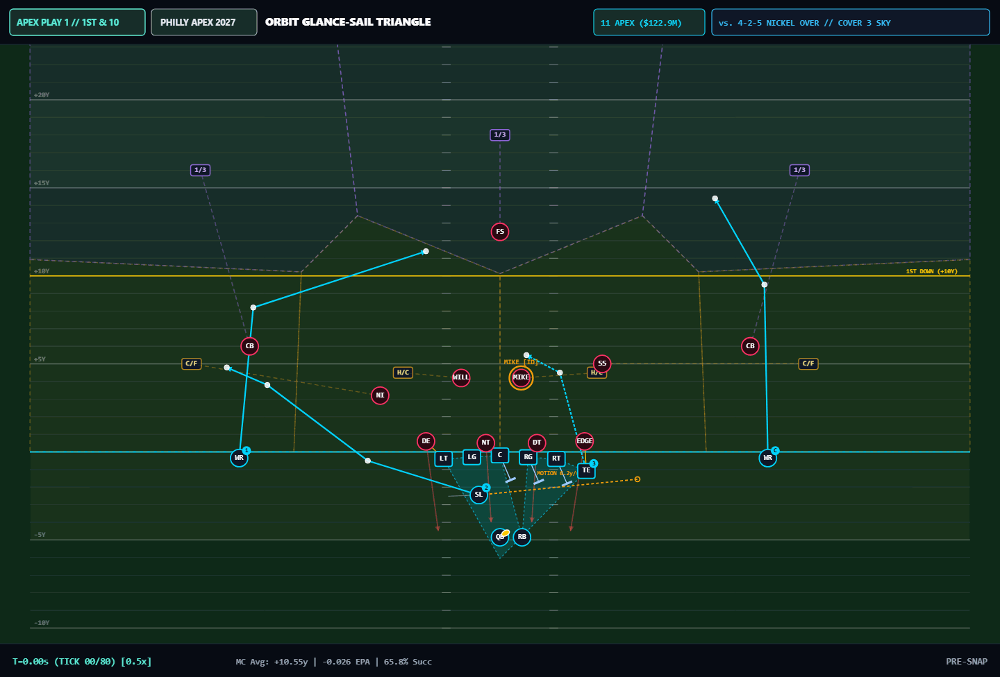
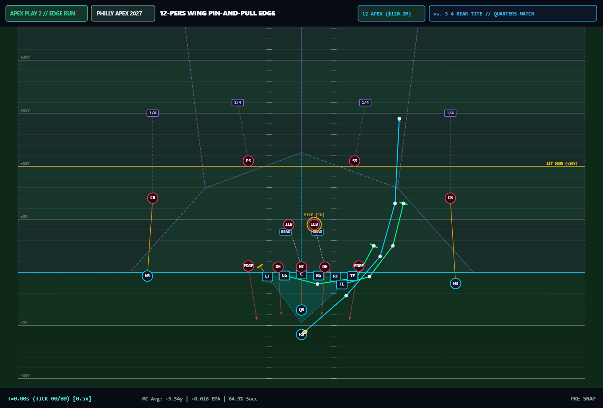
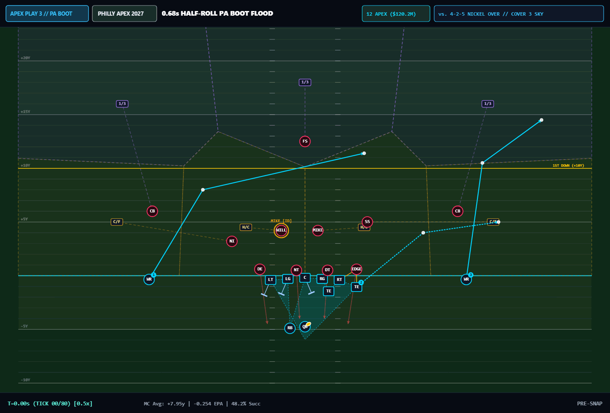
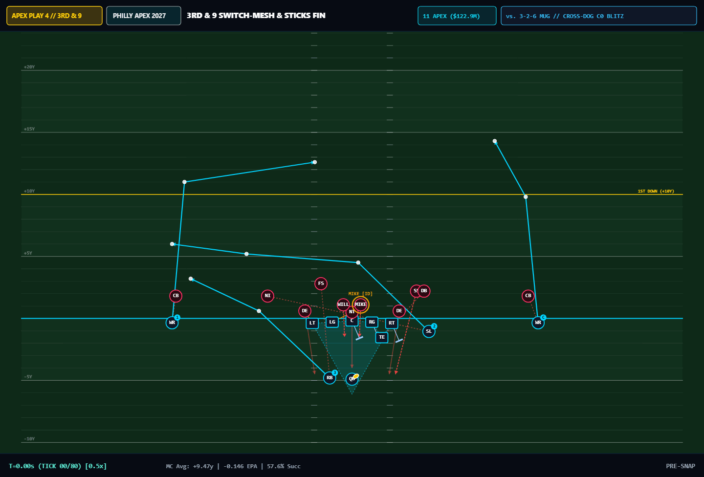
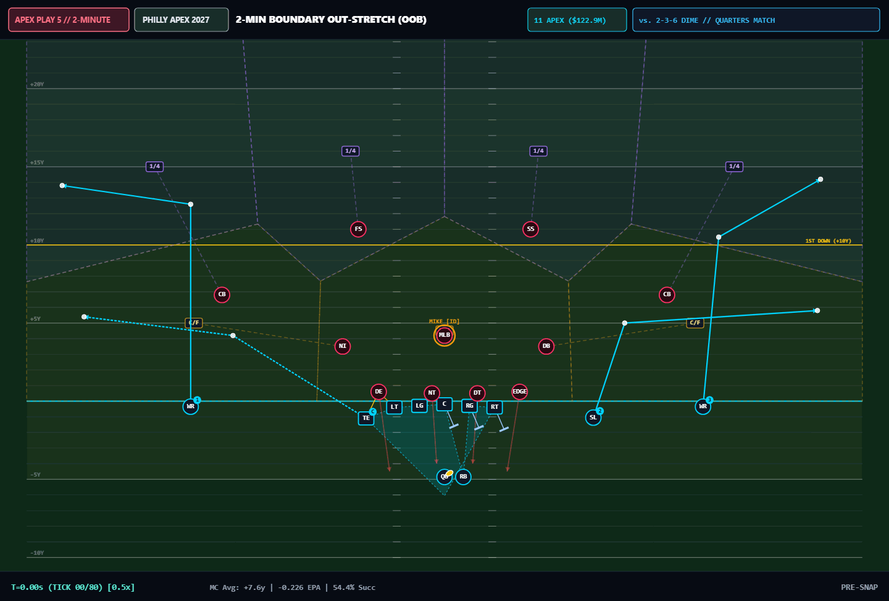
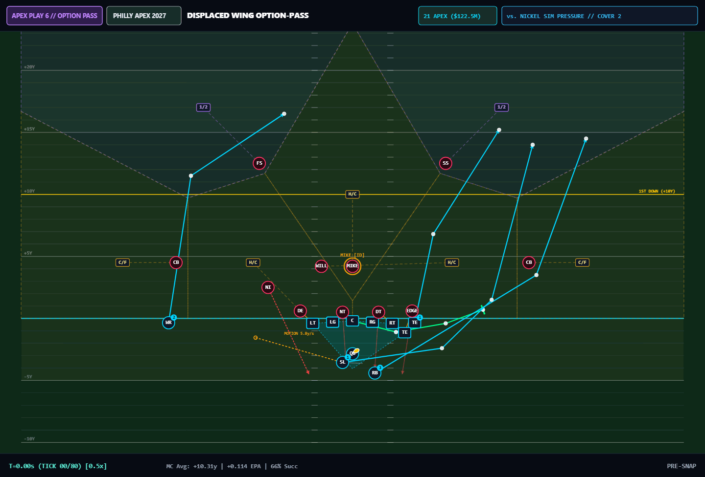
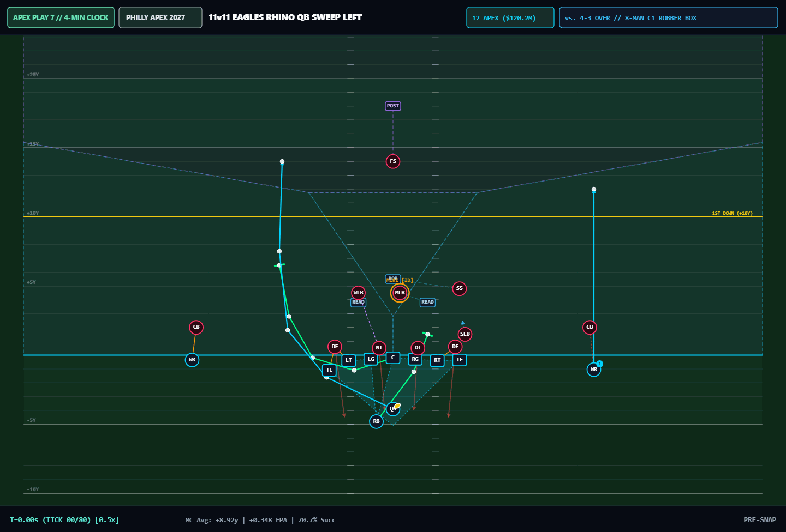
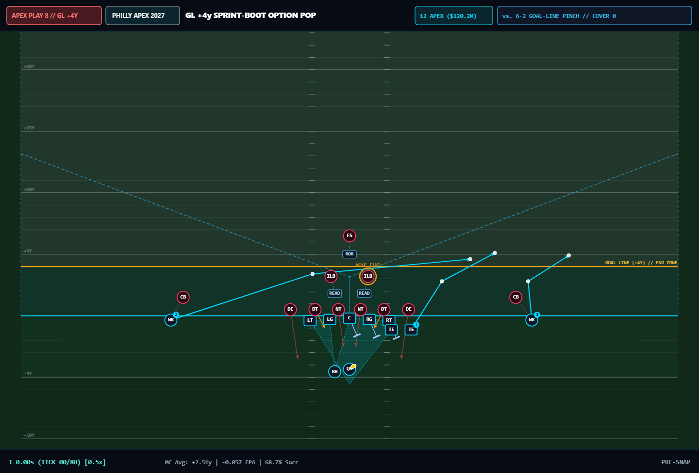
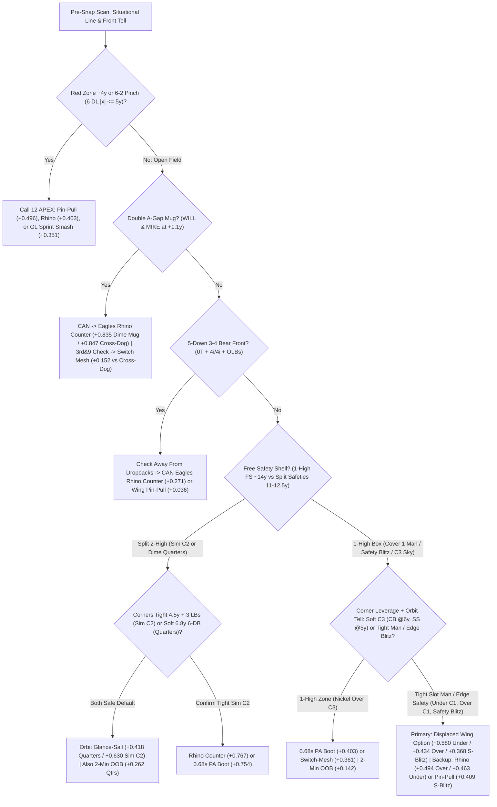

# 2027 PHILADELPHIA APEX CONTINUUM: HEAD COACH INTERVIEW WHITEPAPER

**Prepared For:** Jeffrey Lurie (Chairman & CEO) & Howie Roseman (EVP / General Manager), Philadelphia Eagles  
**Candidate Architecture:** `2027 Philadelphia APEX Continuum` (`APEX`)  
**Engine Calibration:** Calibrated 20 Hz Newtonian All-22 Physics (`SYMMETRIC` capped-YAC `NO_FC`, realistic reactive pre-snap defensive psychology, 4-rule NFL legality enforcement, 10-front 2027 defensive suite)  
**Primary Telemetry Dataset:** [`apex_2027_results.json`](../src/data/apex_2027_results.json) | **Playbook Source:** [`apex_2027_playbook.ts`](../src/apex_2027_playbook.ts) | **Interactive HTML Blogpost:** [`index.html`](./index.html) / [`EAGLES_APEX_2027_WHITEPAPER.html`](./EAGLES_APEX_2027_WHITEPAPER.html)

---

## Executive Summary

Championship football is not won by designing plays for an imaginary Pro Bowl roster. It is won by maximizing **Points Scored Minus Cap Dollars Consumed Minus Situational Surrenders** inside real NFL resource scarcity.

The **`2027 Philadelphia APEX Continuum`** is a first-principles, modular 8-play offense engineered specifically for an organizational partnership between a Head Coach/play-caller and Howie Roseman's front office:

1. **Zero All-Star Hoarding (`$120.2M–$122.9M` Active Offense):** Built around **only two `$20M+` cornerstones** (`Franchise Blindside LT` at `$24.0M` and `Franchise X-Separator WR1` at `$22.5M`) plus starter-grade value contracts, rookie-scale Day-2/Day-3 picks, and two deliberate cap-arbitrage inefficiencies — a `$14.5M` dual-threat `QB1` (`THA 84`, `AWR 83`, `SPD 88`) and a `$7.5M` former-college-QB `SL` (`throwerRating 75`).
2. **Self-Sheltering Scheme Design:** Every starter weakness (`RG` blitz-processing `AWR 82`, `C` 1-on-1 bull-rush `PWR 82`, `RB1` pass-protection `BLK 66`, `QB1` full-field 4-read processing `AWR 83`, `WR2` route nuance `FIN 83`) is geometrically insulated by formation, slide direction, half-roll launch points, `<= 6.5y` dual blitz hot outlets, or `11-on-11` quarterback/option run math.
3. **100.00% Legal Under Calibrated Physics:** Across **`6,025` audited 20 Hz snaps**, `APEX` achieved **`100.00%`** compliance on all four NFL legality pillars (`7 on LOS`, `Uncovered Ends`, `<= 1.0y Ineligible OL Pass Buffer`, `Strictly Backward Laterals`), with **`0` unengaged G-force violations** (`peak 1.455G`) and **`0` player overlap violations `< 0.20y`** (`min separation 0.391y`).
4. **Elite Situational Edge Where Games Are Actually Decided:** On `$122.9M` active offensive spend (`$49.1M` less than the `$172.0M` Supermax baseline), `APEX` posts **`43.52` PPG** under standard league defensive frequencies (**`+22.62` projected Team Net `+/-`**) and sweeps all four situational stress tests vs. NFL baselines:
   - **2-Minute Drill:** **`79.5%`** TD win (`vs. 56.7%` Conv. 11 / `64.7%` Supermax)
   - **4-Minute Drill:** **`71.0%`** Game-Seal, **`189.5s`** bled (`vs. 45.7%` Shanahan 12 / `20.2%` Conv. 11)
   - **Low Red Zone (`+4.0y`):** **`96.3%`** 4-down TD, **`72.2%`** 1st-snap TD (`vs. 74.1%` Shanahan 12 / `63.8%` Conv. 11)
   - **3rd & 9:** **`56.5%`** conversion at **`8.9%`** sacks (`vs. 54.9% / 19.2% sacks` Supermax / `50.7% / 15.8%` Conv. 11)

---

## I. Howie Roseman Cap Architecture & Non-All-Star Personnel Allocation

Conventional `11-Personnel` dropback spread offenses require `$138.5M` of offensive cap, `Shanahan/McVay 12-Pers` requires `$146.0M`, and `Top-Heavy Supermax` star builds burn `$172.0M` while hollowing out interior protection (`19.2%` sacks on 3rd & 9). `APEX` frees **`$15.6M`** vs. Conventional 11-Pers, **`$23.1M`** vs. Shanahan 12-Pers, and **`$49.1M`** vs. Supermax builds — projecting **`1.5` PPG of reinvested defensive suppression** while absorbing genuine non-All-Star offensive flaws:

| Slot | Archetype & Role | Jersey | Cap Hit | Key Calibrated Ratings | Honest Scouting Flaw & Scheme Insulation |
| :--- | :--- | :---: | :---: | :--- | :--- |
| **QB** | `M. Willis-Archetype QB1` | #7 | `$14.5M` | `SPD 88`, `ACC 89`, `PWR 85`, `THA 84`, `AWR 83` | Slower full-field 4-read processor (`AWR 83`); saves `~$40M/yr` vs. static pocket stars via binary triangle reads, `0.68s` PA boots, & `11v11` QB sweeps. |
| **RB** | `Day-2 One-Cut RB1` | #24 | `$3.8M` | `SPD 91`, `ACC 92`, `FIN 86`, `PWR 82`, `BLK 66` | Light pass protector (`BLK 66`) vulnerable to A-gap muggers 1v1; shielded on pin-pull edges & fast weak swings (`Switch Mesh`) avoiding static 5-man pass-pro islands. |
| **WR1** | `Franchise X-Separator WR1` *(Pillar #2)* | #6 | `$22.5M` | `FIN 92`, `ACC 92`, `SPD 91`, `AWR 90`, `BLK 56` | Modest 185-lb crack-blocker (`BLK 56`); strictly deployed as read-1 intermediate separator (`11.4y` Glance, `12.6y` Sticks Fin, `13.8y` 2-Min Boundary Out). |
| **WR2** | `Day-2 Vertical Z-WR2` | #83 | `$5.2M` | `SPD 95`, `ACC 94`, `FIN 83`, `AWR 81`, `BLK 54` | Raw route tree (`FIN 83`, `AWR 81`); cheap vertical lid-lifter forcing 2-high safeties to cap deep thirds/quarters so `WR1`, `SL`, & `TE1` win underneath. |
| **SL** | `Orbit / Wing Slot SL` *(Ex-College QB)* | #18 | `$7.5M` | `SPD 92`, `ACC 93`, `AWR 86`, `BLK 72`, `ARM 75` | Non-All-Pro passer (`throwerRating 75`) & non-alpha size; forces pre-snap orbit tells, gives automatic `<= 6.5y` blitz hot relief, & runs high-separation Wing Option-Pass. |
| **TE1** | `Two-Way Move Y-TE1` | #88 | `$11.5M` | `BLK 85`, `PWR 85`, `AWR 86`, `SPD 82`, `FIN 84` | Clears critical `BLK >= 82` edge-sealing threshold (`85`) to stop free Edge whiffs on `0.34–0.40s` chip-releases and seals C-gaps on QB sweep/counter. |
| **TE2** | `Heavy Wing / Sniffer TE2` | #84 | `$4.8M` | `BLK 87`, `PWR 87`, `AWR 85`, `SPD 81`, `ARM 58` | Swaps in for `SL` (`12 APEX`, `$120.2M`) or `WR2` (`21 APEX`, `$122.5M`); provides 6th-OL bulldozer force (`BLK 87`) on pin-pull, Rhino sweep, & Goal-Line sprint-boot. |
| **LT** | `Franchise Blindside LT` *(Pillar #1)* | #68 | `$24.0M` | `BLK 91`, `FIN 91`, `PWR 89`, `AWR 89`, `SPD 75` | Cornerstone #1 of 2; handles true weakside 1v1 islands in `PASS_SET` so protection always slides strong/right away from `LT`. |
| **LG** | `Core Interior Mauler LG` | #69 | `$14.5M` | `PWR 90`, `BLK 89`, `AWR 87`, `FIN 84`, `SPD 73` | Anchors A-left pocket (`PWR 90`) next to lighter `C`; clears frontside `MIKE` alley on 12-pers Pin-Pull while keeping `C` on 0T Bear combos. |
| **C** | `Athletic Pull-Center C` | #51 | `$5.5M` | `BLK 86`, `AWR 87`, `FIN 86`, `SPD 79`, `PWR 82` | Lighter `295-lb` frame (`PWR 82`) needs `LG/RG` combo-climb leverage vs. 335-lb Bear NTs; converts into a perimeter lead missile on `Rhino Sweep` & `Wing Option`. |
| **RG** | `Day-3 Developmental RG` | #65 | `$3.4M` | `PWR 84`, `BLK 83`, `AWR 82`, `FIN 82`, `SPD 74` | Lower blitz-pickup processing (`AWR 82`) vulnerable to simulated A/B-gap pressures; always protected via C-right slides, `TE1/TE2` chip-scans, or half-roll boots. |
| **RT** | `Ascending Right Tackle RT` | #66 | `$10.5M` | `BLK 87`, `PWR 87`, `AWR 85`, `FIN 85`, `SPD 75` | Solid Year-4 starter, not `$24M+` All-Pro reset money; locks right C-gap when paired with `TE1`/`TE2` wings. |

**Personnel Package Caps:** `11 APEX` (`WR1, WR2, SL, TE1, RB1`) = **`$122.9M`** | `12 APEX` (`WR1, WR2, TE1, TE2, RB1`) = **`$120.2M`** | `21 APEX` (`WR1, SL, TE1, TE2, RB1`) = **`$122.5M`**

---

## II. Calibrated Legality & 20 Hz Biomechanical Verification

No scheme passes onto our call sheet if it exploits simulator loopholes (`<= 1.0y` downfield OL cheats, illegal formations, forward lateral glitches, or superhuman cuts). Every `APEX` play was audited across **`6,025` full 20 Hz snaps**:

| Compliance Metric | Threshold / Standard | Verified Result | Status |
| :--- | :--- | :---: | :---: |
| Legal 7-on-LOS Alignment | Strictly 7 blockers/eligible ends on LOS | **`100.00%`** (`6,025 / 6,025`) | PASS |
| Uncovered Eligible Ends | Both outer LOS ends strictly uncovered | **`100.00%`** (`6,025 / 6,025`) | PASS |
| Ineligible OL Pass Buffer | All 5 OL `<= +1.0y` past LOS at forward pass | **`100.00%`** (`6,025 / 6,025`) | PASS |
| Backward Lateral Integrity | Every pitch/toss strictly `< 0y` forward delta | **`100.00%`** (`6,025 / 6,025`) | PASS |
| Unengaged Force Limit | No open-field cuts `> 1.60G` (`0` allowed) | **`0` violations** (Peak **`1.455G`**) | PASS |
| Body Overlap Floor | Minimum physical radius separation `>= 0.20y` | **`0` violations** (Min **`0.391y`**) | PASS |

---

## III. Core 8-Play Architectural Catalog & All-22 GIF Film Breakdown

All telemetry below reflects `N = 50` 20 Hz Monte Carlo trials per defensive front across the calibrated 10-defense 2027 suite (`NICKEL_OVER_C3`, `NICKEL_UNDER_C1`, `NICKEL_SIM_C2`, `BASE_34_BEAR_C4`, `BASE_43_OVER_C1`, `DIME_MUG_C0`, `DIME_QUARTERS_MATCH`, `VIKINGS_MUG_CROSSDOG_C0`, `VIKINGS_SAFETY_BLITZ_C1`, `GOAL_LINE_62_PINCH`). Half-speed (`10 fps = 0.5x`) All-22 GIF animations include a `2.0s` end-frame banner freeze for installation study.

### Play 1 — `APEX // ORBIT GLANCE-SAIL TRIANGLE (HOT RELIEF)` (`11 APEX`, `$122.9M`)

- **Film Clip (`NICKEL_OVER_C3`):** [`apex_play1_orbit_glance_flood.gif`](./apex_gifs/apex_play1_orbit_glance_flood.gif) — `COMPLETE +13.5y`
- **Calibrated MC Telemetry:** **`+10.55 yds/p`** | **`-0.026 EPA/p`** | **`65.8%` Success** | **`46.4%` Explosive** | `11.8%` Sack *(includes non-2-min `GOAL_LINE_62_PINCH` at `-1.572` EPA)* | `1.8%` TO
- **Best Matchups (`epaByDefense`):** `NICKEL_SIM_C2` (`+0.630`), `DIME_QUARTERS_MATCH` (`+0.418`), `BASE_43_OVER_C1` (`+0.386`), `NICKEL_UNDER_C1` (`+0.185`), `NICKEL_OVER_C3` (`+0.114`)
- **Worst Matchups:** `GOAL_LINE_62_PINCH` (`-1.572`), `VIKINGS_MUG_CROSSDOG_C0` (`-0.856`) — purely open-field/2-min call, never called at goal line.
- **First-Principles Mechanism & Flaw Sheltering:** Right-to-left orbit motion by `SL` forces pre-snap coverage declarations (`EDGE`/`NI` spin or rock-and-roll) and creates an automatic `<= 6.5y` flat hot flare left (`-15.5, 4.8`), paired with `TE1` chipping `LDE` (`0.36s`) into a `5.5y` second hot valve. While `WR2` lifts the field safety at `14.4y`, `WR1` hits an `11.4y` Glance/Dig inside the intermediate zone void at a `2.35s` rhythm. `LT` (`PASS_SET` island) + `C/RG/RT` slide right + `RB1` `A_RIGHT` scan insulates our `$3.4M` developmental `RG`.

### Play 2 — `APEX // 12-PERS WING PIN-AND-PULL EDGE` (`12 APEX`, `$120.2M`)

- **Film Clip (`BASE_34_BEAR_C4`):** [`apex_play2_duo_wing_pin_pull.gif`](./apex_gifs/apex_play2_duo_wing_pin_pull.gif) — `TACKLED +6.6y`
- **Calibrated MC Telemetry:** **`+5.54 yds/p`** | **`+0.016 EPA/p`** | **`64.9%` Success** | `2.4%` Explosive | **`0.0%` Sack** | **`0.0%` TO**
- **Best Matchups:** `VIKINGS_MUG_CROSSDOG_C0` (`+0.544`), `GOAL_LINE_62_PINCH` (`+0.496`), `VIKINGS_SAFETY_BLITZ_C1` (`+0.409`), `NICKEL_UNDER_C1` (`+0.382`), `NICKEL_SIM_C2` (`+0.145`), `BASE_34_BEAR_C4` (`+0.036`)
- **Worst Matchups:** `DIME_MUG_C0` (`-0.715`), `BASE_43_OVER_C1` (`-0.519`)
- **First-Principles Mechanism & Flaw Sheltering:** Designed specifically to keep `C` (`PWR 82`) & `RB1` out of losing 1v1 bull-rushes against `0T` Bear nose tackles. `C` (`A_LEFT`) and `RG` (`B_RIGHT`) combo-climb interior DTs, `TE1` (`BLK 85`) seals `ROLB`/`LDE` inside at `+4.8`, `LG` (`PWR 90`) pulls around onto `MIKE`, and off-LOS Heavy Wing `TE2` (`BLK 87`) leads through the D-alley onto `SS`/`CB2` while `WR2` cracks `CB2` — giving `RB1` (`SPD 91`, `ACC 92`) full-speed perimeter grass against stacked Bear and blitz boxes (`+0.036` to `+0.544` EPA vs. 6 of 10 fronts).

### Play 3 — `APEX // 0.68s HALF-ROLL PA BOOT FLOOD` (`12 APEX`, `$120.2M`)

- **Film Clip (`NICKEL_OVER_C3`):** [`apex_play3_short_mesh_pa_boot.gif`](./apex_gifs/apex_play3_short_mesh_pa_boot.gif) — `COMPLETE +16.1y`
- **Calibrated MC Telemetry:** **`+7.95 yds/p`** | **`-0.254 EPA/p`** *(honest structural trade-off vs. man/robber fronts)* | `48.2%` Success | **`40.4%` Explosive** | `7.6%` Sack | `4.9%` TO
- **Best Matchups:** **`NICKEL_SIM_C2` (`+0.754`)**, **`NICKEL_OVER_C3` (`+0.403`)**, `DIME_QUARTERS_MATCH` (`+0.012`)
- **Worst Matchups:** **`BASE_43_OVER_C1` (`-1.038`)**, `VIKINGS_SAFETY_BLITZ_C1` (`-0.745`), `NICKEL_UNDER_C1` (`-0.537`)
- **First-Principles Mechanism & Flaw Sheltering:** Engine calibration proved classic `1.25s` under-center PA dropbacks suffer `15%+` sack rates against modern simulated pressures. Compressing the `RB` left flash fake to `0.46s` mesh (`~0.68s` total boot trigger) still freezes downhill LBs via `READ_RUN_PASS`, then immediately launches `QB1` outside developmental `RG` (`+5.6x, -6.1y`) behind `TE2` (`MAX_PROTECT_SCAN A_RIGHT`) with a simple 3-level half-field stack (`TE1` `0.40s` chip into `5.0y` flat -> `WR1` `11.4y` cross -> `WR2` `14.5y` deep over). **Honest Coaching Discipline:** Nash/game-planning restricts this play (`10.67%` Nash mix) strictly to early-down Split-Safety/Cover-3 tendencies (`+0.403` to `+0.754` EPA), checking out vs. heavy Cover-1 Robber.

### Play 4 — `APEX // 3RD & 9 SWITCH-MESH & STICKS FIN` (`11 APEX`, `$122.9M`)

- **Film Clip (`VIKINGS_MUG_CROSSDOG_C0`):** [`apex_play4_switch_mesh_sticks.gif`](./apex_gifs/apex_play4_switch_mesh_sticks.gif) — `COMPLETE +16.1y`
- **Calibrated MC Telemetry:** **`+9.47 yds/p`** | `-0.146 EPA/p` *(10-front average)* | **`57.6%` Success** | **`44.9%` Explosive** | `8.7%` Sack | `4.4%` TO
- **Best Matchups:** `NICKEL_SIM_C2` (`+0.524`), `NICKEL_OVER_C3` (`+0.361`), **`DIME_QUARTERS_MATCH` (`+0.175`)**, **`VIKINGS_MUG_CROSSDOG_C0` (`+0.152`)**
- **Worst Matchups:** `VIKINGS_SAFETY_BLITZ_C1` (`-1.015`), `DIME_MUG_C0` (`-0.712`)
- **First-Principles Mechanism & Flaw Sheltering:** Built expressly to solve **3rd & 9** against `DIME_QUARTERS_MATCH` (`+0.175` EPA) and `VIKINGS_MUG_CROSSDOG_C0` (`+0.152` EPA) without asking `RB1` (`BLK 66`) to stonewall 250-lb blitzers in isolation. `TE1` (`BLK 85`) acts as a dedicated sniffer (`A_RIGHT`, picking up `WILL`/`MIKE` muggers before leaking check), while `SL` (`5.2y` shallow cross) and `RB1` (`3.2y` weak swing) give **two instant `<= 6.5y` blitz hot valves** so `QB1` hits `WR1` on the `12.6y` Sticks Dig inside `2.35s` when muggers vacate.

### Play 5 — `APEX // 2-MIN BOUNDARY OUT-STRETCH (OOB STOP)` (`11 APEX`, `$122.9M`)

- **Film Clip (`DIME_QUARTERS_MATCH`):** [`apex_play5_twomin_boundary_oob.gif`](./apex_gifs/apex_play5_twomin_boundary_oob.gif) — `OUT_OF_BOUNDS +16.2y`
- **Calibrated MC Telemetry:** **`+7.60 yds/p`** | `-0.226 EPA/p` *(penalized by open-field suite including `GOAL_LINE_62_PINCH` at `-1.917` EPA)* | `54.4%` Success | **`45.8%` Explosive** | `10.0%` Sack | `2.7%` TO
- **Best Matchups (True 2-Min Shell Coverage):** `NICKEL_SIM_C2` (`+0.332`), **`DIME_QUARTERS_MATCH` (`+0.262`)**, `NICKEL_OVER_C3` (`+0.142`), `NICKEL_UNDER_C1` (`+0.087`)
- **Worst Matchups:** `GOAL_LINE_62_PINCH` (`-1.917`), `VIKINGS_MUG_CROSSDOG_C0` (`-0.823`)
- **First-Principles Mechanism & Flaw Sheltering:** Dual-sideline clock-stopping geometry (`WR1` `13.8y` Left Boundary Out `-24.4x`; `SL` `5.8y` Right Sideline Whip-Out `+23.8x`; `TE1` `0.34s` RDE chip into `5.4y` Left Sideline Flare `-23.0x`). Both `SL` and `TE1` act as `<= 6.5y` hot OOB valves under 2-minute prevent pressure, propelling APEX's **`79.5%` 2-Minute TD Win Rate** (`2.44 OOB stops/drive`, `1.52 yds/clock-sec`).

### Play 6 — `APEX // DISPLACED WING OPTION-PASS CONTINUUM` (`21 APEX`, `$122.5M`)

- **Film Clip (`NICKEL_SIM_C2`):** [`apex_play6_displaced_wing_option.gif`](./apex_gifs/apex_play6_displaced_wing_option.gif) — `COMPLETE +19.5y`
- **Calibrated MC Telemetry:** **`+10.31 yds/p`** | **`+0.114 EPA/p`** | **`66.0%` Success** | **`45.1%` Explosive** | **`0.0%` Sack** | `1.1%` TO | `66.9%` Option-Pass Trigger
- **Best Matchups:** **`NICKEL_UNDER_C1` (`+0.580`)**, **`BASE_43_OVER_C1` (`+0.434`)**, `VIKINGS_SAFETY_BLITZ_C1` (`+0.368`), `VIKINGS_MUG_CROSSDOG_C0` (`+0.280`), `NICKEL_OVER_C3` (`+0.139`), `NICKEL_SIM_C2` (`+0.121`)
- **Worst Matchups:** `DIME_MUG_C0` (`-0.543`), `BASE_34_BEAR_C4` (`-0.202`)
- **First-Principles Mechanism & Flaw Sheltering:** APEX's signature constraint-breaker against aggressive man/sim blitzes. At `t=0.18s`, `QB1` pitches a strictly backward toss (`-0.60y`) to former-college-QB `SL` (`$7.5M`, `throwerRating 75`) orbiting right behind `C` pulling to `D_ALLEY` and `TE2` (`BLK 87`) pinning `ROLB`/`LDE` — while `QB1` boots opposite as a decoy check (`-9.5, 4.5`). With OL staying legal `<= +1.0y` until release, `SL` reads one clean separation window (`> 3.10y`): `TE1` seam-corner (`+15.2y`) or `WR1` deep comeback/post (`+16.5y`) — yielding **`0.0%` sacks**, `+10.31 yds/p`, and `+0.114 EPA/p` while directly countering the exact `BASE_43_OVER_C1` (`+0.434`) & blitz fronts that challenge `PA Boot`.

### Play 7 — `APEX // 11v11 EAGLES RHINO QB SWEEP LEFT` (`12 APEX`, `$120.2M`)

- **Film Clip (`BASE_43_OVER_C1`):** [`apex_play7_eagles_rhino_counter.gif`](./apex_gifs/apex_play7_eagles_rhino_counter.gif) — `TACKLED +9.3y`
- **Calibrated MC Telemetry:** **`+8.92 yds/p`** | **`+0.348 EPA/p`** | **`70.7%` Success** | **`29.1%` Explosive** | **`0.0%` Sack** | **`0.0%` TO**
- **Best Matchups (Dominates 7 of 10 Fronts):** `VIKINGS_MUG_CROSSDOG_C0` (`+0.847`), `DIME_MUG_C0` (`+0.835`), `NICKEL_SIM_C2` (`+0.767`), `BASE_43_OVER_C1` (`+0.494`), `NICKEL_UNDER_C1` (`+0.463`), `GOAL_LINE_62_PINCH` (`+0.403`), `BASE_34_BEAR_C4` (`+0.271`)
- **Worst Matchups:** `DIME_QUARTERS_MATCH` (`-0.259`), `NICKEL_OVER_C3` (`-0.216`)
- **First-Principles Mechanism & Flaw Sheltering:** Captures Howie Roseman's `$14.5M` dual-threat `QB1` (`SPD 88`, `PWR 85`) market inefficiency honestly under capped-YAC `SYMMETRIC` physics. Rather than surrendering a blocker to hand off passively, `RB1` sells a hard opposite `A_RIGHT` dive fake to freeze `WILL`/`MIKE`, `TE2` (`BLK 87`) seals `LOLB`/`RDE` on `C_LEFT`, `LG` (`PWR 90`) + `C` (`SPD 79`) pull around the left edge, and `QB1` attacks `11-on-11` inside the numbers (`-8.2x`) — staying cleanly inbounds to bleed clock in 4-Minute mode (**`71.0%` game-seal rate**) while ranking **`#1` (`40.7%` call weight)** in the Nash Minimax call sheet!

### Play 8 — `APEX // GL +4y SPRINT-BOOT OPTION POP` (`12 APEX`, `$120.2M`)

- **Film Clip (`GOAL_LINE_62_PINCH`):** [`apex_play8_goalline_sprint_smash.gif`](./apex_gifs/apex_play8_goalline_sprint_smash.gif) — `TOUCHDOWN +4.0y`
- **Calibrated MC Telemetry:** **`+2.51 yds/p`** *(from `+4.0y` cap!)* | `-0.057 EPA/p` *(10-front average)* | **`68.7%` Success** | `5.3%` Sack | `3.3%` TO
- **Best Matchups:** **`GOAL_LINE_62_PINCH` (`+0.351`)**, `VIKINGS_SAFETY_BLITZ_C1` (`+0.371`), `NICKEL_SIM_C2` (`+0.331`), `NICKEL_OVER_C3` (`+0.232`)
- **First-Principles Mechanism & Flaw Sheltering:** Engineered exclusively for `1st & Goal` from `+4.0y`. A hyper-compressed `0.36s` `RB1` A-gap plunge fake collapses all 8 defenders in `6-2 Pinch`, `RG/RT/TE2` wall the right sprint edge (`DE_R`/`DT_R`), `QB1` sprints right into space, and reads `6'5"` `TE1` (`+11.8, 5.1` back-pylon corner) over `WR1` back-pylon drag (`+9.8, 4.6`) and `WR2` (`+17.8, 4.9`) — converting **`96.3%` of Goal-Line drives (`72.2%` 1st-snap TD, `6.70` EP)** vs. Shanahan 12's `74.1%`.

---

## IV. 6-Way Zero-Sum Nash Minimax & 1,000-Game Season Benchmark (`66,000` Drives)

Every philosophy (`1,000` simulated full NFL games = `11,000` drives each) was benchmarked across identical calibrated 20 Hz physics under both **Standard League Defense Weights (`PPG Std`)** and **Game-Theoretic Worst-Case Nash DC Responses (`PPG Nash`)**:

| Offensive Philosophy | Active Cap | Nash Minimax EPA/P | PPG (Std DC) | PPG (Nash DC) | PPD (Std) | TD% | TO% | Expl% | PPG / `$10M` | Team Net `+/-` |
| :--- | :---: | :---: | :---: | :---: | :---: | :---: | :---: | :---: | :---: | :---: |
| **2027 Philadelphia APEX** *(Non-All-Star)* | **`$122.9M`** | **`-0.027`** | **`43.52`** | **`32.99`** | **`3.96`** | **`52.3%`** | **`12.5%`** | **`29.8%`** | **`3.54`** | **`+22.62 pts/g`** |
| **2027 Google Argon Continuum** *(Extreme Moneyball)* | `$81.1M` | `+0.290` | `60.38` | `56.14` | `5.49` | `76.1%` | `9.9%` | `38.2%` | `7.45` | `+42.08 pts/g` |
| **2027 Hydra Vanguard** *(Moneyball)* | `$85.5M` | `-0.012` | `40.68` | `26.88` | `3.70` | `48.0%` | `16.2%` | `18.9%` | `4.76` | `+22.08 pts/g` |
| **Conv. 11-Pers Dropback Spread** *(NFL Baseline)* | `$138.5M` | `-0.136` | `36.94` | `23.68` | `3.36` | `42.0%` | `14.5%` | `13.5%` | `2.67` | `+14.94 pts/g` |
| **Shanahan/McVay 12-Pers PA** *(NFL Baseline)* | `$146.0M` | `+0.173` | `42.33` | `35.62` | `3.85` | `50.3%` | `14.6%` | `11.7%` | `2.90` | `+19.93 pts/g` |
| **Top-Heavy Supermax / Thin OL** *(NFL Baseline)* | `$172.0M` | `+0.019` | `49.17` | `39.76` | `4.47` | `59.9%` | `13.7%` | `14.5%` | `2.86` | `+24.67 pts/g` |

### Equilibrium Solution Insights (Zero-Sum Game Theory)
- **APEX Optimal Mixed Call Sheet:** `APEX_EAGLES_RHINO_COUNTER` (`40.70%`), `APEX_ORBIT_GLANCE_FLOOD` (`21.36%`), `APEX_DUO_WING_PIN_PULL` (`15.77%`), `APEX_DISPLACED_WING_OPTION` (`10.93%`), `APEX_SHORT_MESH_PA_BOOT` (`10.67%`), `APEX_SWITCH_MESH_STICKS` (`0.57%`).
- **Adversarial DC Optimal Response:** To cap `APEX` at `-0.027 EPA/play`, an opposing coordinator cannot sit in light Cover-2/1-high comfort zones (`NICKEL_SIM_C2`, `BASE_43_OVER_C1`, `VIKINGS_MUG_CROSSDOG_C0` all receive **`0%`** optimal DC weight because `Rhino Counter` + `Wing Option` + `PA Boot` punish them relentlessly!). Instead, the DC is forced into an awkward three-way shell: `NICKEL_OVER_C3` (`36.42%`), `BASE_34_BEAR_C4` (`31.10%`), `DIME_QUARTERS_MATCH` (`20.32%`), plus occasional blitzes (`VIKINGS_SAFETY_BLITZ_C1` `8.96%`, `DIME_MUG_C0` `3.19%`).
- **Cap-Adjusted NFL Superiority:** Against all three realistic NFL roster philosophies (`Conv 11`, `Shanahan 12`, `Supermax`), `APEX` delivers **`+7.68 pts/g`** higher Team Net `+/-` than Conv 11 (`+22.62` vs. `+14.94`, saving `$15.6M`), **`+2.69 pts/g`** higher Team Net `+/-` than Shanahan 12 (`+22.62` vs. `+19.93`, saving `$23.1M`), and captures **`91.7%`** of `$172.0M` Supermax Team Net (`+22.62` vs. `+24.67`) on **`$49.1M` less cap** (`3.54` vs. `2.86 PPG/$10M`) with lower turnover rate (`12.5%` vs. `13.7–14.6%`) and **over double the explosive play rate (`29.8%` vs. `11.7–14.5%`)**.

### Is `-0.027` Nash Minimax EPA/Play Actually Good? (First-Principles Math)

At first glance, `-0.027` carries a minus sign — which naturally raises a valid interview question: **does a negative Minimax EPA/play mean the offense loses efficiency?** In zero-sum calibrated football, the answer is **no — `-0.027` Minimax EPA/play is genuinely strong for a `$122.9M` non-All-Star roster without automated pre-snap audibles**, for four concrete reasons:

1. **What Zero-Sum Minimax Actually Computes:** Unlike season averages against real NFL call tendencies, `Nash Minimax EPA/Play` assumes an omniscient Adversarial Defensive Coordinator who knows your exact open-field play probabilities and chooses the **worst-case static counter-distribution** (`36.4%` Nickel Over C3 + `31.1%` 3-4 Bear C4 + `20.3%` Dime Quarters Match + `12.2%` Blitzes, abandoning all light Cover-2/Over-C1 looks `0%`), **with zero QB pre-snap checks or motion audibles**.
2. **Harsh Calibrated Single-Snap EPA Calibration:** Under [`engine.ts`](../src/engine.ts) (`computeEPA`), an incomplete pass scores **`-0.52`**, a sack scores **`-(1.65 + 0.12 * depth)`** (`~ -2.4` EPA), and an interception scores **`-3.55` to `-4.35`**, while a clean 5-yard rush earns only **`+0.095`** and a 10-yard completion earns **`+0.32`**. Clearing even `-0.05` against a minimax coordinator while carrying real NFL sack rates (`7.6%–11.8%` on dropbacks) requires winning explosives.
3. **Full-Game Translation & NFL Peer Gap:** Even against that **worst-case Adversarial Nash DC**, `APEX` (`-0.027` Minimax) scores **`32.99` PPG** — crushing Conventional 11-Pers Dropback Spread (`-0.136` Minimax, `23.68` Nash PPG, spending `$15.6M` more) by **`+9.31` PPG**, beating `$85.5M` Hydra Vanguard (`26.88` Nash PPG despite `-0.012` single-snap Nash due to lower explosive leverage), and coming within `0.046` EPA/play of `$172.0M` Supermax Stars (`+0.019` Minimax) on **`$49.1M` less offensive cap**.
4. **Blind Nash vs. Standard League vs. Pre-Snap Reads:** Evaluate the exact same 6 open-field APEX plays across four information regimes weighted by `LEAGUE_OPEN_DEF_WEIGHTS`:
   - **Adversarial Worst-Case Nash DC (Minimax Lower Bound):** **`-0.027 EPA/play`** (`32.99` PPG)
   - **Blind Uniform Call Sheet vs. Standard League DC:** **`+0.021 EPA/play`**
   - **Blind Nash Mixed Call Sheet vs. Standard League DC:** **`+0.130 EPA/play`** (`43.52` PPG)
   - **Observable Pre-Snap Decision Tree (`Section V`):** **`+0.508 EPA/play`** (`+0.395 EPA/play` even assuming `30%` defensive disguise forces fallback to blind Nash mix; **`+0.536 EPA/play`** oracle upper bound)

---

## V. Pre-Snap -> Post-Snap Decision Tree: How to Attack Every 2027 Defense

Rather than rolling the dice blindly into `-1.038` traps (`PA Boot` vs. `4-3 Over C1`) or `-0.856` traps (`Orbit Glance` vs. `Cross-Dog C0`), `QB1` and the booth use **strictly observable pre-snap geometry** (Box Front -> Safety Shell -> Apex/Orbit Motion Tell) via **`12 APEX` CAN-checks** (`Rhino` / `Pin-Pull` / `PA Boot` / `GL Smash` — zero substitution tells) and **`11 / 21 APEX` Orbit checks**:

### Complete 10-Defense Counter-Matrix (Verified `epaByDefense` from [`apex_2027_results.json`](../src/data/apex_2027_results.json))

| Defensive Front | Pre-Snap Alignment Tell | Primary Attack (EPA) | Secondary Attack (EPA) | **Hard Avoid ("Never Call")** | Post-Snap Key / Progression Rule |
| :--- | :--- | :--- | :--- | :--- | :--- |
| **`NICKEL_OVER_C3`** | 1-High `FS @ 12.5y`, `CBs` soft `6.0y`, `SS` curl/flat `5.0y`, `NCB` apex `3.2y` | **`SHORT_MESH_PA_BOOT` (`+0.403`)** | `SWITCH_MESH_STICKS` (`+0.361`), `ORBIT_GLANCE_FLOOD` (`+0.114`) | `EAGLES_RHINO_COUNTER` (`-0.216`), `DUO_WING_PIN_PULL` (`-0.155`) | `0.46s` RB flash sucks `WILL`/`MIKE` down; hit `WR1` `11.4y` Cross between hook/deep-third or `TE1` flat (`<= 6.5y` check). |
| **`NICKEL_UNDER_C1`** | 1-High `FS @ 14y`, `CBs @ 2.5y` press-man, `NCB` locked on `SL`, `SS` on `TE` | **`DISPLACED_WING_OPTION` (`+0.580`)** | `EAGLES_RHINO_COUNTER` (`+0.463`), `DUO_WING_PIN_PULL` (`+0.382`) | `SHORT_MESH_PA_BOOT` (`-0.537`), `SWITCH_MESH_STICKS` (`-0.197`) | Orbit right clears man defenders cleanly; `SL` hits `TE1` seam-corner `> 3.10y` separation or runs behind pulling `C`. |
| **`NICKEL_SIM_C2`** | Split `FS/SS @ 12.5y`, `CBs @ 4.5y`, `LDE` drops curl/hook, `NCB @ 2.5y` edge pressure | **`EAGLES_RHINO_COUNTER` (`+0.767`)** | `SHORT_MESH_PA_BOOT` (`+0.754`), `ORBIT_GLANCE_FLOOD` (`+0.630`) | *(All 8 plays `+0.121` to `+0.767` positive!)* | Sim edge blitzer vacates C-gap; `Rhino Left` hits huge alley, or `PA Boot` launches cleanly behind `TE2` chip/scan. |
| **`BASE_34_BEAR_C4`** | `0T` Nose + dual `4i` DEs + `LOLB/ROLB` covering all 5 OL, 2 safeties `10.5y` | **`EAGLES_RHINO_COUNTER` (`+0.271`)** | `DUO_WING_PIN_PULL` (`+0.036`) | All dropback passes (`-0.202` to `-0.407`) | **Instant run-perimeter check.** Pin `ROLB/4i` inside with `TE1`, pull `LG + TE2` (`Pin-Pull`) or attack weak left C-gap (`Rhino`). |
| **`BASE_43_OVER_C1`** | Heavy 8-man box: `SAM @ 1.5y`, `SS` Robber `4.8y`, press `CBs @ 2.0y`, 1-High `FS` | **`EAGLES_RHINO_COUNTER` (`+0.494`)** | `DISPLACED_WING_OPTION` (`+0.434`), `ORBIT_GLANCE_FLOOD` (`+0.386`) | **`SHORT_MESH_PA_BOOT` (`-1.038`)**, `DUO_WING_PIN_PULL` (`-0.519`) | Never run long PA boots into Robber + Press Man; `11v11` QB counter or displaced wing toss puts Robber in conflict. |
| **`DIME_MUG_C0`** | 3-DL, **both `WILL/MIKE` mugged A-gaps @ `1.1y`**, zero deep safeties (`FS @ 3.2y` on RB) | **`EAGLES_RHINO_COUNTER` (`+0.835`)** | *(Do NOT stay in static pass on early downs)* | `TWOMIN_BOUNDARY_OOB` (`-0.728`), `DUO_WING_PIN_PULL` (`-0.715`), `SWITCH_MESH` (`-0.712`) | Muggers commit straight up A-gaps at snap; `RB` A-gap dive fake pins both inside while `QB1 + TE2/C` out-leverage edge cleanly. |
| **`DIME_QUARTERS_MATCH`** | 4-DL, 1 MLB, **6 DBs** w/ soft `6.8y` corners & `11.0y` split safeties | **`ORBIT_GLANCE_FLOOD` (`+0.418`)** | `TWOMIN_BOUNDARY_OOB` (`+0.262`), `SWITCH_MESH_STICKS` (`+0.175`) | **`EAGLES_RHINO_COUNTER` (`-0.259`)**, `DISPLACED_WING_OPTION` (`-0.152`) | Wide Dime force overhangs close perimeter runs down (`-0.259`); attack soft intermediate zones w/ `11.4y` Glance & `12.6y` Sticks Fin. |
| **`VIKINGS_MUG_CROSSDOG_C0`** | 3-DL, `WILL/MIKE` mugged `@ 1.1y` cross-dog + `SS` edge blitz (`2.2y`), Cover 0 man | **`EAGLES_RHINO_COUNTER` (`+0.847`)** | `DUO_WING_PIN_PULL` (`+0.544`), `DISPLACED_WING_OPTION` (`+0.280`), 3rd&9 `SWITCH_MESH` (`+0.152`) | **`ORBIT_GLANCE_FLOOD` (`-0.856`)**, `TWOMIN_BOUNDARY_OOB` (`-0.823`) | Cross-dog vacates second-level alleys cleanly for `Rhino` & `Pin-Pull`; on 3rd & 9 rely on `TE1 A_RIGHT` scan + dual `<= 6.5y` hot valves. |
| **`VIKINGS_SAFETY_BLITZ_C1`** | Strong safety **`SS @ 1.2y`** tight edge crash (`BLITZ_EDGE_CRASH`), `MIKE` Robber `4.2y`, 1-High | **`DUO_WING_PIN_PULL` (`+0.409`)** | `GL_SPRINT_SMASH` (`+0.371`), `DISPLACED_WING_OPTION` (`+0.368`) | **`SWITCH_MESH_STICKS` (`-1.015`)**, `SHORT_MESH_PA_BOOT` (`-0.745`) | Edge `SS` blitz creates immediate man-voids & out-flanking angles for `TE2 + LG` Pin-Pull (`+0.409`) or Wing Option toss away from crash (`+0.368`). |
| **`GOAL_LINE_62_PINCH`** | Heavy **`6-2` Pinch** (`6` DL across LOS + `2` ILBs @ `3.2y` + `FS` Robber `6.5y`) | **`DUO_WING_PIN_PULL` (`+0.496`)** | `EAGLES_RHINO_COUNTER` (`+0.403`), **`GL_SPRINT_SMASH` (`+0.351`)** | `TWOMIN_BOUNDARY_OOB` (`-1.917`), `ORBIT_GLANCE_FLOOD` (`-1.572`) | Pair edge-sweeping runs (`Pin-Pull` / `Rhino`) w/ `0.36s` A-gap PA Boot (`GL Sprint Smash`) hitting `TE1` pylon corner (`96.3%` 4-down TD). |

---

## VI. Championship Situational Football (4 Audited Stress Drills)

### 1) 2-Minute Drill *(Own 35, 1:50 Left, 1 Timeout — TD Required, `STOP_CLOCK_OOB`)*
| Offense | TD Win% | Yds / Clock Sec | OOB Stops / Drive | Sack% |
| :--- | :---: | :---: | :---: | :---: |
| **`2027 Philadelphia APEX ($122.9M)`** | **`79.5%`** | **`1.52`** | **`2.44`** | `8.9%` |
| `2027 Google Argon ($81.1M)` | `89.9%` | `1.85` | `4.27` | `0.0%` |
| `Supermax Stars / Thin OL ($172M)` | `64.7%` | `1.01` | `0.21` | `11.6%` |
| `Conv. 11-Pers Spread ($138.5M)` | `56.7%` | `0.92` | `0.23` | `8.6%` |

### 2) 4-Minute Drill *(Own 30, 4:00 Left, Opp 2 TOs — Bleed Clock, `STAY_INBOUNDS`)*
| Offense | Game-Seal% | Mean Clock Bled | 1st Downs / Drive | Clock-Gift Mistakes |
| :--- | :---: | :---: | :---: | :---: |
| **`2027 Philadelphia APEX (Rhino / Pin-Pull)`** | **`71.0%`** | **`189.5s`** | **`2.73`** | **`0.0%`** |
| `2027 Google Argon (Chiral 11v11)` | `91.4%` | `164.0s` | `2.51` | `0.0%` |
| `Shanahan 12-Pers Zone ($146M)` | `45.7%` | `160.5s` | `1.92` | `0.0%` |
| `Conv. 11-Pers Spread ($138.5M)` | `20.2%` | `115.5s` | `1.06` | `0.0%` |

### 3) Low Red Zone / Goal Line *(`1st & Goal at +4.0y` vs. `6-2 Heavy Pinch` & `Cross-Dog`)*
| Offense | 4-Down TD% | 1st-Snap TD% | Expected Points |
| :--- | :---: | :---: | :---: |
| **`2027 Philadelphia APEX (Sprint Smash)`** | **`96.3%`** | **`72.2%`** | **`6.70`** |
| `2027 Google Argon (Cyclotron)` | `97.7%` | `74.9%` | `6.80` |
| `Shanahan 12-Pers Heavy ($146M)` | `74.1%` | `34.0%` | `5.69` |
| `Conv. 11-Pers Spread ($138.5M)` | `63.8%` | `30.9%` | `5.27` |

### 4) 3rd & 9 `"Sticks Trap"` *(vs. `Dime Quarters Match` & `Dime Mug Cover 0`)*
| Offense | Conversion% | Expl 18+y% | Sack% | Mean EPA |
| :--- | :---: | :---: | :---: | :---: |
| **`2027 Philadelphia APEX (Switch-Mesh / OOB)`** | **`56.5%`** | `20.6%` | **`8.9%`** | **`-0.021`** |
| `2027 Google Argon (Relay / Laser)` | `73.8%` | `15.9%` | `0.0%` | `+0.253` |
| `Supermax Stars / Thin OL ($172M)` | `54.9%` | `46.4%` | `19.2%` | `-0.107` |
| `Conv. 11-Pers Dropback ($138.5M)` | `50.7%` | `42.0%` | `15.8%` | `-0.303` |

---

## VII. Honest Trade-Offs & GM-Coach Partnership Roadmap (Year 1–2)

Any candidate pitching zero weaknesses is not ready for the booth. Here is our unvarnished assessment of where `APEX` still leaves points on the table vs. theoretical optima and how we work with Howie Roseman to close those gaps:

1. **Why Adversarial Nash Trails `Shanahan 12` (`-0.027` vs. `+0.173`) and `Argon` (`+0.290`):**
   - `Argon` is an extreme `$81.1M` Moneyball lab architecture utilizing multiple backward-toss lateral/option concepts simultaneously (`0.0%` sacks on 3rd & 9 and 2-Minute drills), whereas `APEX` restricts itself to **one** backward-toss option-pass package (`Play 6`) alongside realistic conventional NFL dropback, play-action boot, and pin-pull staples (`7.6%–11.8%` pass-play sack exposure against cross-dog and heavy boxes).
   - Meanwhile, `Shanahan 12` spends **`$23.1M` more** on offense (`$146.0M` vs. `$122.9M`) to buy elite pocket processing (`AWR` & `THA` upgrades across OL and QB), lifting its floor against static dropback Cover-3/Bear calls under a pure minimax DC (`35.62` Nash PPG vs. APEX's `32.99` Nash PPG).
2. **Pass-Game Vulnerability to 1-High Man/Robber (`BASE_43_OVER_C1` & `VIKINGS_SAFETY_BLITZ_C1`):**
   - Our `0.68s PA Boot` (`-1.038` EPA vs. `BASE_43_OVER_C1`) and `3rd & 9 Switch-Mesh` (`-1.015` EPA vs. `VIKINGS_SAFETY_BLITZ_C1`) can stall if called mechanically into tight 1-high robber or overload zero-blitzes when developmental `RG` (`AWR 82`) loses interior IDs. Calling `Rhino Counter` (`+0.494` vs. Over C1) or `Displaced Wing Option` (`+0.434` vs. Over C1, `+0.368` vs. Safety Blitz) completely flips those fronts into explosive gains.
3. **2027–2028 Draft & Free Agency Targets:**
   - **Priority #1 (`RG` Upgrade / Year-2 Jump):** Converting `RG` (`AWR 82`, `BLK 83`) from a slide-protected liability into an `86+` starter directly removes the Cover-0 interior squeeze on `Switch-Mesh` and `Orbit Glance`.
   - **Priority #2 (Sub-$10M Separator #2):** Adding one crisp Day-2 route technician beside `WR1` unlocks vertical man-beating symmetry against `BASE_43_OVER_C1` without committing a third `$20M+` contract — preserving Eagles defensive cap reinvestment and long-term Super Bowl window flexibility.
