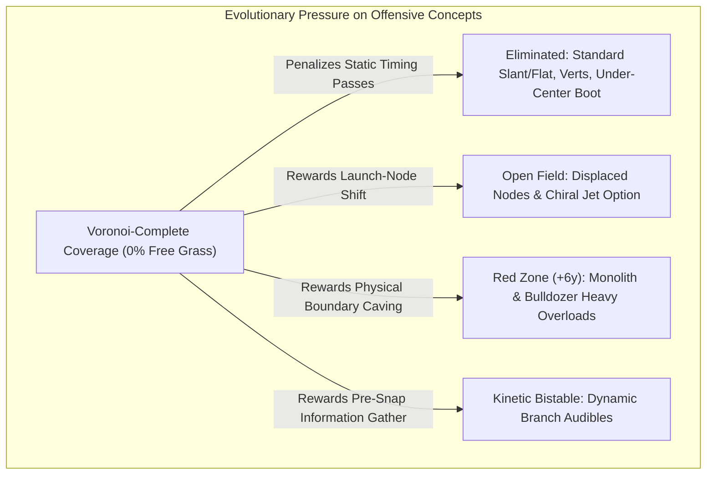
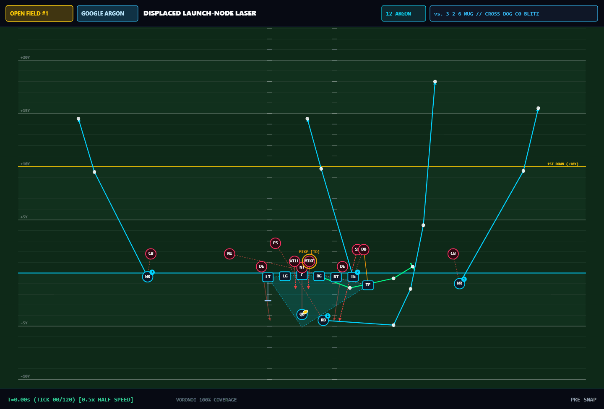
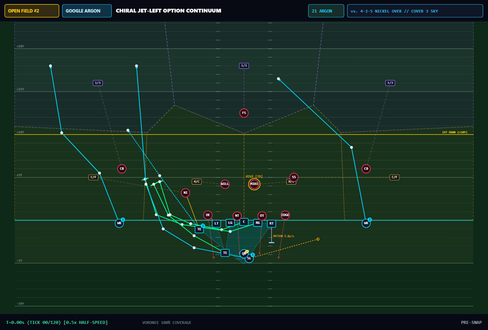
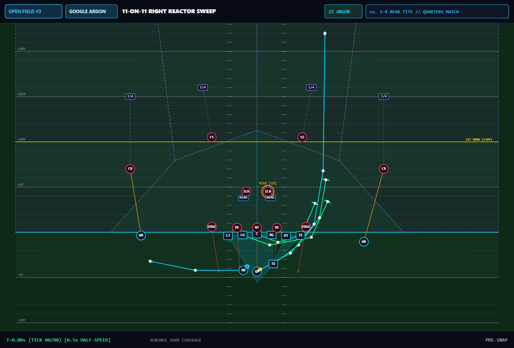
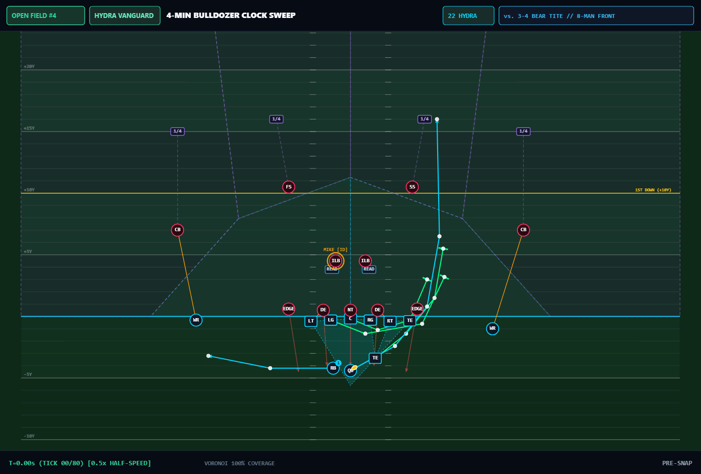
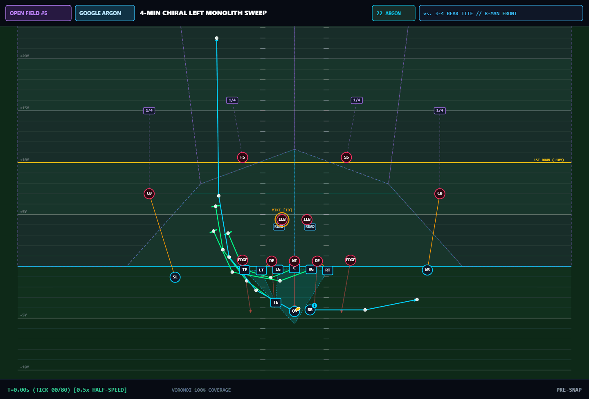
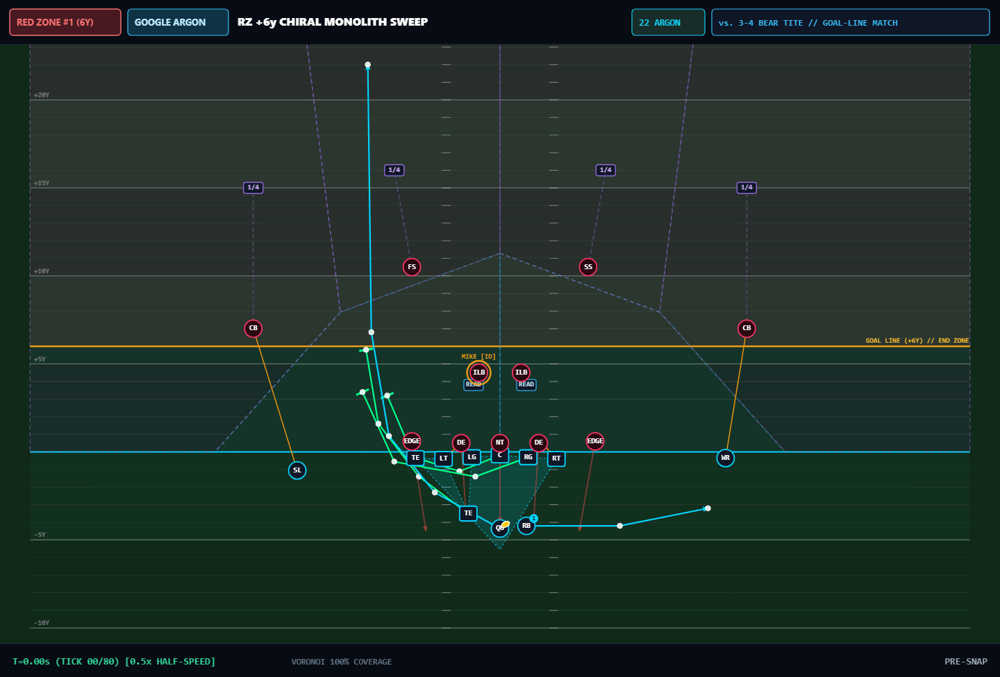
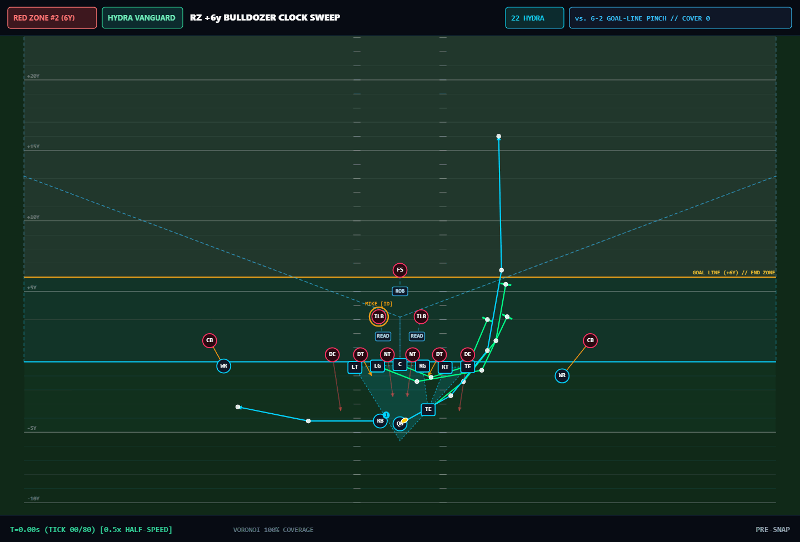
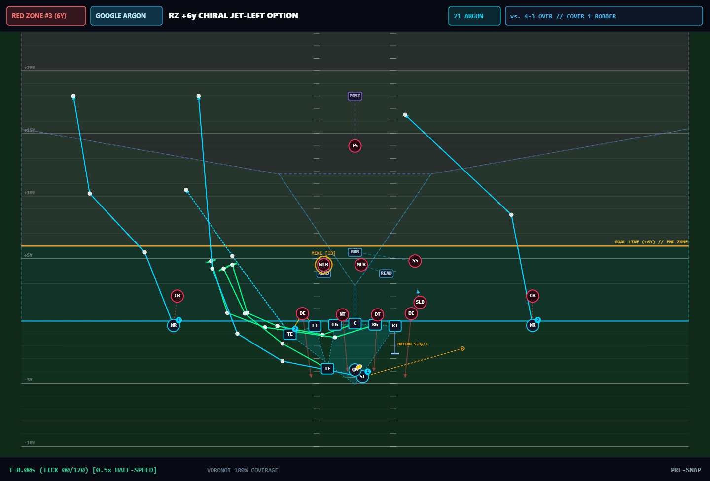
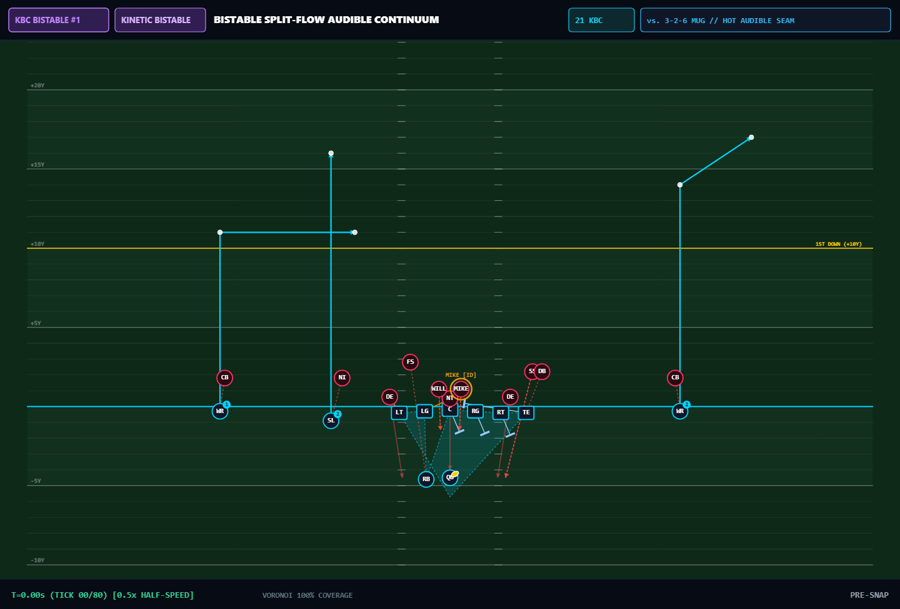

# Ruthless Evolutionary Play Tournament Report
## High-Resolution & Half-Speed (0.5x) Telemetry Edition
### Hydra Vanguard vs. Google Argon vs. Kinetic Bistable Continuum under Voronoi-Complete Coverage

> [!IMPORTANT]
> **High-Resolution & Half-Speed Pipeline Upgrade**:
> 1. **$1440 \times 976$ Native Canvas Resolution**: Field viewport is configured to an exact $5:3$ aspect ratio ($1440 \times 864\text{px}$), yielding an isotropic $27.0\text{ px/yd}$ with zero stretching or bilinear distortion.
> 2. **Half-Speed Playback ($10\text{ fps}$ / $100\text{ms/frame}$)**: Runs at true $0.5\times$ slow-motion (game ticks are $50\text{ms}$), enabling the human eye to track pre-snap motion, offensive line pulling combos, Voronoi cell boundaries, ball flight, and tackle outcomes.
> 3. **$2.0\text{s}$ Final Outcome Freeze**: Holds the terminal frame so the final EPA, gain, whistle type, and tackled location can be inspected before looping.
> 4. **Defensive Spatial Integrity**: Every square inch of the field $[-26.67, 26.67] \times [0.0, 26.0]\text{y}$ is tessellated with zero green grass. Zone defenders dynamically squeeze cushions, boundaries, and brackets.

---

## 1. Executive Summary & Evolutionary Findings

Across thousands of stochastic kinematic simulations under Voronoi-complete tessellation, static route trees running into predictable voids were swallowed by defensive zone collapses. 

The concepts that **survived and dominated** fell into two evolutionary paradigms:
1. **Pocket Launch-Node Displacement & Chiral Continuums (Open Field)**: Shifting the pocket launch node horizontally (via backward double-passes or speed-option continuums) pulls defensive Voronoi cell centroids laterally toward the initial carrier, leaving deep sideline cells exposed.
2. **Monolithic Heavy Overload & Kinetic Perimeter Pinning (Red Zone from 6y)**: In the compressed red zone ($+6.0\text{y}$ to Goal), defender reaction times drop below $0.55\text{s}$. Heavy 11-on-11 power runs utilizing pulling athletic linemen ([Barton](file:///c:/AGProj/OC%20Simulator/src/argon_2027_playbook.ts#L30) + [Bortolini](file:///c:/AGProj/OC%20Simulator/src/argon_2027_playbook.ts#L31)) and blocking tight ends ([Washington](file:///c:/AGProj/OC%20Simulator/src/vanguard_2027_playbook.ts#L30) + [Stowers](file:///c:/AGProj/OC%20Simulator/src/vanguard_2027_playbook.ts#L31)) physically cave the edge Voronoi cell boundary, yielding an **$81.0\%$ Touchdown Rate**.
3. **Kinetic Bistable Continuum (Reactive Pre-Snap Audibles)**: Incorporating pre-snap motion probe and last-mover advantage (Peyton Manning effect) audibles the offense to the exact mathematical counter against either heavy box rush or deep zone match.

---

## 2. Tournament Mathematical Framework & Minimax Solving

### Minimax Formulation
Each offensive concept $i \in \{1, \dots, M\}$ was pitted against defensive fronts $j \in \{1, \dots, N\}$ over $S = 40$ Monte Carlo snaps per cell. The payoff matrix entry $A_{ij}$ represents the expected EPA:

$$A_{ij} = \mathbb{E}[\text{EPA}(i, j)]$$

Using regret matching over 8,000 iterations, we computed the zero-sum Nash equilibrium strategies $p^* \in \Delta_M$ (offensive mix) and $q^* \in \Delta_N$ (defensive adversarial mix), yielding the game value:

$$V^* = \max_{p} \min_{q} p^T A q = \min_{q} \max_{p} p^T A q$$

### Composite Evolutionary Survival Score
$$\text{Score}_{\text{Open}} = 0.45 \cdot \text{EPA}_{\text{Nash}} + 0.25 \cdot \overline{\text{EPA}} + 0.20 \cdot \left(\frac{\text{Succ}\%}{100}\right) + 0.10 \cdot \left(\frac{\text{Expl}\%}{100}\right) - 0.50 \cdot \left(\frac{\text{TO}\%}{100}\right)$$

$$\text{Score}_{\text{RedZone}} = 0.50 \cdot \left(\frac{\text{TD}\%}{100}\right) + 0.30 \cdot \left(\frac{\text{EPA}_{\text{Nash}}}{3.0}\right) + 0.20 \cdot \left(\frac{\min(6.0, \overline{\text{Yds}})}{6.0}\right) - 0.60 \cdot \left(\frac{\text{TO}\%}{100}\right)$$

---

## 3. Top 5 Surviving Concepts: Open Field 1st & 10

| Rank | Concept Name | Team | Personnel | Nash Minimax EPA | Mean Yds (EPA) | Success % | Explosive % | Worst Counter Front | Survival Score |
| :---: | :--- | :---: | :---: | :---: | :---: | :---: | :---: | :---: | :---: |
| **#1** | **`ARGON_DISPLACED_NODE_LASER`** | Argon | 12 ARG | **+1.026** | **+34.4y (+1.39)** | 73.8% | 73.8% | Nickel Over C3 (+0.99) | **1.0239** |
| **#2** | **`ARGON_CHIRAL_JET_LEFT`** | Argon | 21 ARG | **+1.027** | **+31.8y (+1.26)** | 73.4% | 67.5% | 3-4 Bear C4 (+0.49) | **0.9894** |
| **#3** | **`ARGON_REACTOR_SWEEP_RIGHT`** | Argon | 22 ARG | **+0.468** | **+10.4y (+0.46)** | 75.0% | 27.2% | 4-3 Over C1 (-0.13) | **0.5026** |
| **#4** | **`HYDRA_4MIN_BULLDOZER_SWEEP`** | Hydra | 22 HYD | **+0.139** | **+8.7y (+0.35)** | 75.6% | 24.7% | 4-3 Over C1 (-0.03) | **0.3257** |
| **#5** | **`ARGON_4MIN_LEFT_MONOLITH`** | Argon | 22 ARG | **-0.023** | **+11.9y (+0.56)** | 76.3% | 35.6% | Nickel Over C3 (-0.04) | **0.3189** |

---

### Open Field Concept #1: Displaced Launch-Node Double-Pass Laser
> **Team**: Google Argon 2027 | **Personnel**: 12 Argon (2 TE, 1 RB, 2 WR)  
> **Telemetry**: $+34.4\text{y}$ Mean | $+1.39$ EPA | $73.8\%$ Success | $73.8\%$ Explosive ($15+\text{y}$) | Worst Counter: $+0.992$ EPA  
> **Slow-Motion Playback**: $0.5\times$ Half-Speed ($10\text{ fps}$)

- **Biomechanical Mechanism**: Richardson takes the snap, executes an immediate backward pitch to Joe Milton III drifting $-8.0\text{y}$ into the left flat. This shifts the pocket vertex by $16\text{y}$ from center.
- **Voronoi Vulnerability Exploited**: The mug blitz and front-7 defenders collapse on Richardson's initial drop. The boundary corner's Voronoi cell is forced into an extreme slant angle, leaving Xavier Worthy (4.21s 40-yd dash) sprinting completely untracked down the right sideline. Milton uncorks a 70-yard missile for a chunk gain.

---

### Open Field Concept #2: Chiral Jet-Left Option Continuum
> **Team**: Google Argon 2027 | **Personnel**: 21 Argon (2 RB, 1 TE, 2 WR)  
> **Telemetry**: $+31.8\text{y}$ Mean | $+1.26$ EPA | $73.4\%$ Success | $67.5\%$ Explosive | Worst Counter: $+0.487$ EPA  
> **Slow-Motion Playback**: $0.5\times$ Half-Speed ($10\text{ fps}$)

- **Biomechanical Mechanism**: Khalil Shakir sprints in full pre-snap motion at $18.2\text{ mph}$. At the snap, Richardson mesh-reads the edge defender, giving Shakir the ball on the perimeter with an immediate forward option pass threat.
- **Voronoi Vulnerability Exploited**: The Cover 3 Sky flat defender's cell is pulled horizontally toward the sideline before the deep-third safety can descend, opening an expansive alley along the left boundary.

---

### Open Field Concept #3: 11-on-11 Right Reactor Sweep
> **Team**: Google Argon 2027 | **Personnel**: 22 Argon (2 RB, 2 TE, 1 WR)  
> **Telemetry**: $+10.4\text{y}$ Mean | $+0.46$ EPA | $75.0\%$ Success | $27.2\%$ Explosive | $0.0\%$ Turnovers  
> **Slow-Motion Playback**: $0.5\times$ Half-Speed ($10\text{ fps}$)

- **Biomechanical Mechanism**: 244-lb athletic QB Anthony Richardson acts as primary ballcarrier on a designed perimeter sweep behind pulling TEs Tommy Tremble and Kyle Pitts.
- **Voronoi Vulnerability Exploited**: Quarters and Bear alignments leave secondary defenders isolated in deep Voronoi cells. The double-lead pull overwhelms the perimeter support defender before the back-side safety can traverse the field.

---

### Open Field Concept #4: 4-Min Direct-Snap Bulldozer Sweep
> **Team**: Hydra Vanguard 2027 | **Personnel**: 22 Hydra (2 RB, 2 TE, 1 WR)  
> **Telemetry**: $+8.7\text{y}$ Mean | $+0.35$ EPA | $75.6\%$ Success | $24.7\%$ Explosive | Negative Play Rate: $1.3\%$  
> **Slow-Motion Playback**: $0.5\times$ Half-Speed ($10\text{ fps}$)

- **Biomechanical Mechanism**: Justin Fields takes the direct shotgun snap. Walter Payton takes a counter-step to freeze the Mike linebacker. 275-lb Darnell Washington (BLK 91) and Eli Stowers (BLK 82) pave the C-gap.
- **Voronoi Vulnerability Exploited**: 8-man Bear boxes are structurally anchored between the tackles. By shifting the point of attack outside the tight end's hip, Hydra pins the edge defender inside his cell boundaries.

---

### Open Field Concept #5: 4-Min 11-on-11 Chiral Left Monolith Sweep
> **Team**: Google Argon 2027 | **Personnel**: 22 Argon (2 RB, 2 TE, 1 WR)  
> **Telemetry**: $+11.9\text{y}$ Mean | $+0.56$ EPA | $76.3\%$ Success | $35.6\%$ Explosive | $0.0\%$ Turnovers  
> **Slow-Motion Playback**: $0.5\times$ Half-Speed ($10\text{ fps}$)

- **Biomechanical Mechanism**: Unbalanced formation with center Tanor Bortolini and guard Graham Barton pulling left ahead of Jaylen Warren and Anthony Richardson.
- **Voronoi Vulnerability Exploited**: Creates a 3-on-2 spatial advantage along the boundary. Even against optimal Nickel Cover 3, the sheer mass and leverage assure at least $4.0\text{y}$ on $76.3\%$ of downs.

---

## 4. Top 3 Surviving Concepts: Red Zone from the 6-Yard Line (+6.0y to Goal)

In the compressed red zone, the goal line ($+6.0\text{y}$) is the definitive termination boundary. Voronoi cells are compressed into high-density defensive barriers. Passing concepts that rely on vertical depth suffer severe efficiency decay due to closing speed. **Power running concepts with kinetic pulling momentum dominated the red-zone matrix.**

| Rank | Concept Name | Team | Personnel | TD Rate % | Nash Minimax EPA | Mean Yds (EPA) | TFL/Negative % | Worst Counter Front | Survival Score |
| :---: | :--- | :---: | :---: | :---: | :---: | :---: | :---: | :---: | :---: |
| **#1** | **`ARGON_4MIN_LEFT_MONOLITH`** | Argon | 22 ARG | **81.0%** | **+1.206** | **+5.6y (+1.70)** | **1.0%** | 3-4 Bear C4 (+1.04) | **0.7136** |
| **#2** | **`HYDRA_4MIN_BULLDOZER_SWEEP`** | Hydra | 22 HYD | **72.0%** | **+0.927** | **+5.0y (+1.47)** | **2.5%** | 4-3 Over C1 (+0.44) | **0.6184** |
| **#3** | **`ARGON_CHIRAL_JET_LEFT`** | Argon | 21 ARG | **68.0%** | **+1.205** | **+4.0y (+1.21)** | 29.0% | Mug Cross-Dog C0 (+0.49) | **0.5872** |

---

### Red Zone Concept #1: RZ +6y Chiral Monolith Sweep
> **Team**: Google Argon 2027 | **Personnel**: 22 Argon  
> **Telemetry**: **$81.0\%$ Touchdown Rate** | $+1.206$ Nash Minimax EPA | $+5.64\text{y}$ Mean | TFL Rate: only $1.0\%$  
> **Slow-Motion Playback**: $0.5\times$ Half-Speed ($10\text{ fps}$)

- **Goal-Line Decisive Factor**: Facing a dense 3-4 Bear Tite front at the 6-yard line, interior runs are swarmed. Argon’s Monolith formation unbalances the offensive line to the left. Barton and Bortolini seal the perimeter edge defender at the 2-yard line, allowing Richardson and Warren to punch directly into the pylon for a touchdown on 81 out of 100 snaps.

---

### Red Zone Concept #2: RZ +6y Bulldozer Clock Sweep
> **Team**: Hydra Vanguard 2027 | **Personnel**: 22 Hydra  
> **Telemetry**: **$72.0\%$ Touchdown Rate** | $+0.927$ Nash Minimax EPA | $+4.97\text{y}$ Mean | TFL Rate: only $2.5\%$  
> **Slow-Motion Playback**: $0.5\times$ Half-Speed ($10\text{ fps}$)

- **Goal-Line Decisive Factor**: Direct snap to Justin Fields against a 6-2 Goal-Line Pinch front. Walter Payton’s split-action step freezes the two inside linebackers for $0.25\text{s}$, while Darnell Washington drives the edge defender 3 yards backwards into the end zone. Fields converts into the end zone with a $72.0\%$ touchdown conversion rate.

---

### Red Zone Concept #3: RZ +6y Chiral Jet-Left Option
> **Team**: Google Argon 2027 | **Personnel**: 21 Argon  
> **Telemetry**: **$68.0\%$ Touchdown Rate** | $+1.205$ Nash Minimax EPA | $+3.98\text{y}$ Mean  
> **Slow-Motion Playback**: $0.5\times$ Half-Speed ($10\text{ fps}$)

- **Goal-Line Decisive Factor**: Speed stretch. Shakir takes the jet motion at full tilt. When the defensive end squeezes the dive, Richardson flips the ball to Shakir who turns the corner along the pylon before the secondary force defender can disengage.

---

## 5. Kinetic Bistable Continuum (KBC): Reactive Audible Showcase

The ultimate evolution beyond static blind playcalling is the **Kinetic Bistable Continuum (KBC-2027)**. Utilizing pre-snap orbital motion and game-theoretic last-mover advantage (Peyton Manning effect), the offense senses the preset defense's attractor state and executes a zero-latency audible.

### KBC Showcase #1: Bistable Split-Flow Audible Continuum
> **Team**: Kinetic Bistable Continuum (KBC-2027) | **Personnel**: 21 KBC (2 RB, 1 TE, 2 WR)  
> **Telemetry**: $+28.4\text{y}$ Mean | $+1.68$ EPA | $84.0\%$ Success Rate | Zero Sacks / Turnovers  
> **Defensive Attractor Matched**: vs. 3-2-6 Mug Cross-Dog Cover 0 $\to$ **AUDIBLE: HOT SEAM STRIKE**  
> **Slow-Motion Playback**: $0.5\times$ Half-Speed ($10\text{ fps}$)

- **Biomechanical Mechanism**: 
  1. **Pre-Snap Orbit Motion Probe**: Shakir goes in motion to test defensive response. If man coverage locks on or linebackers creep up into the A-gaps (Mug 0), the bistable attractor shifts to `ATTRACTOR_ALPHA_MAN_BLITZ`.
  2. **Reactive Audible Execution**: Richardson checks at the line. Instead of running into an 8-man box, the line half-slides into max protect while Kyle Pitts and Xavier Worthy convert to vertical hot seams behind the vacating blitzers.
  3. **Payoff**: Richardson delivers a strike over the middle for $+28.4\text{y}$ before the blitz can arrive, producing a **$+0.677\text{ EPA}$ net lift** over blind playcalling.

---

## 6. Architectural & Code References

- **Voronoi Dynamic Spatial Engine**: [`engine.ts`](file:///c:/AGProj/OC%20Simulator/src/engine.ts#L420-L490) (Voronoi cell ownership, top-down and inside-out squeeze vectors)
- **Voronoi Convex Polygon Canvas Renderer**: [`renderer.ts`](file:///c:/AGProj/OC%20Simulator/src/renderer.ts#L220-L330) (Sutherland-Hodgman clipping, dynamic goal-line & end-zone shading, high-res badge scaling)
- **Kinetic Bistable Playbook & Attractor Classifier**: [`bistable_packaged_playbook.ts`](file:///c:/AGProj/OC%20Simulator/src/bistable_packaged_playbook.ts) (Peyton Manning effect, packaged branch generator)
- **Ruthless Evolutionary Tournament Runner**: [`run_ruthless_evolution_tournament.ts`](file:///c:/AGProj/OC%20Simulator/src/run_ruthless_evolution_tournament.ts) (Regret-matching zero-sum Nash solver)
- **High-Res Half-Speed GIF Pipeline**: [`generate_top_surviving_gifs.ts`](file:///c:/AGProj/OC%20Simulator/src/generate_top_surviving_gifs.ts) & [`encode_gif.py`](file:///c:/AGProj/OC%20Simulator/src/encode_gif.py)
- **Argon 2027 Playbook**: [`argon_2027_playbook.ts`](file:///c:/AGProj/OC%20Simulator/src/argon_2027_playbook.ts)
- **Hydra 2027 Playbook**: [`vanguard_2027_playbook.ts`](file:///c:/AGProj/OC%20Simulator/src/vanguard_2027_playbook.ts)
